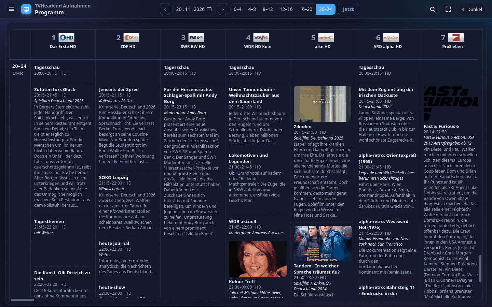
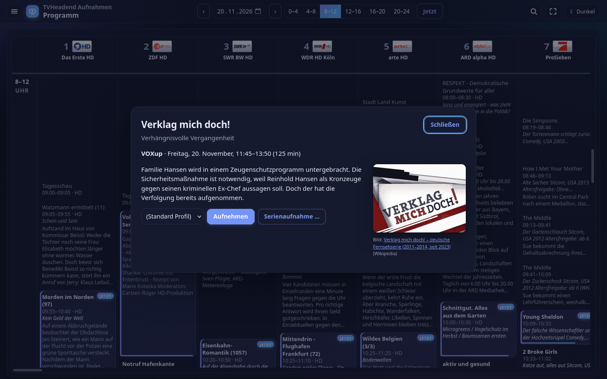
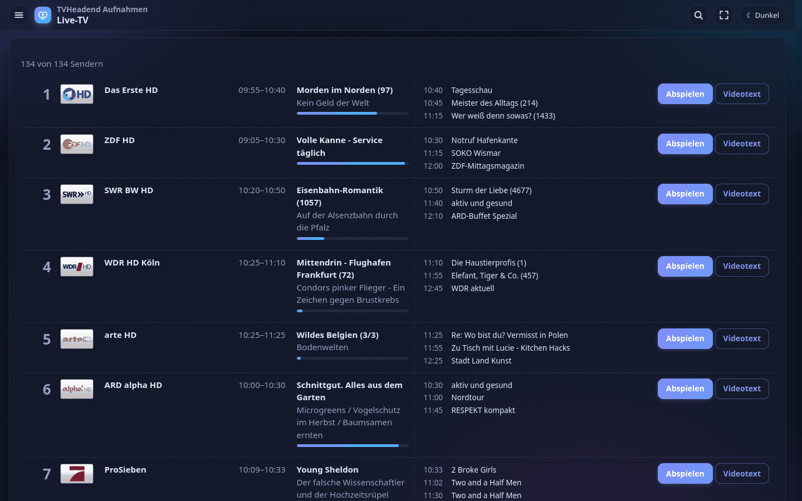
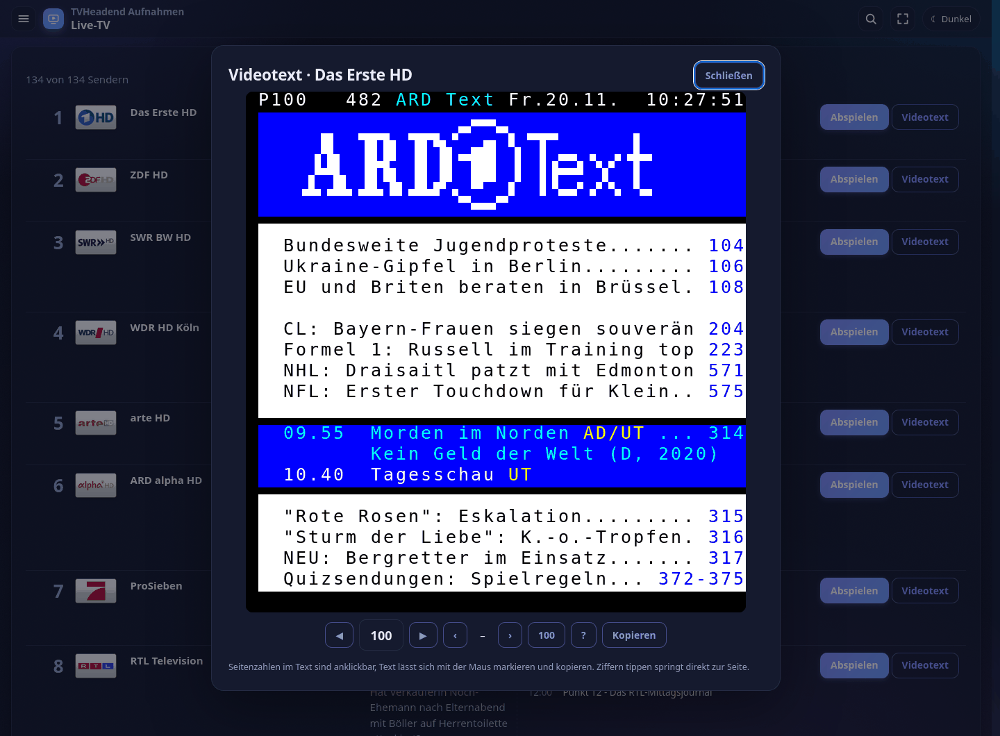
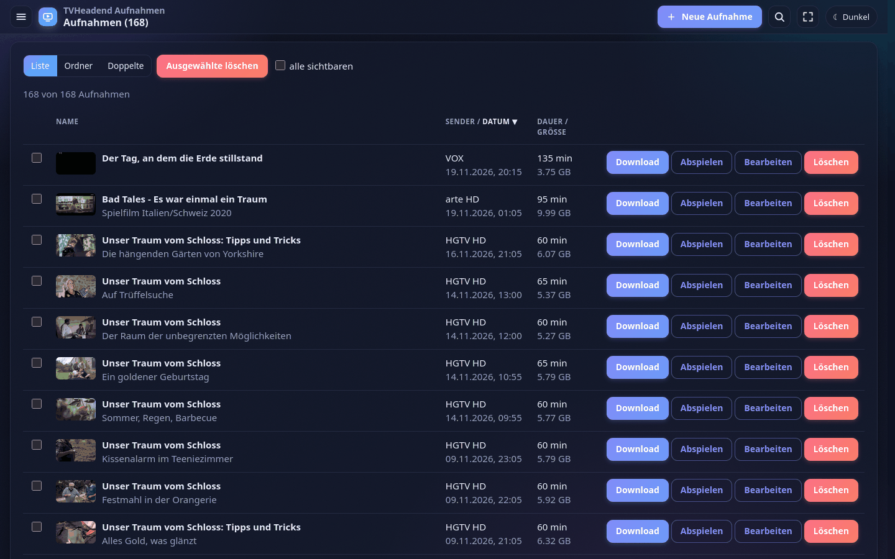
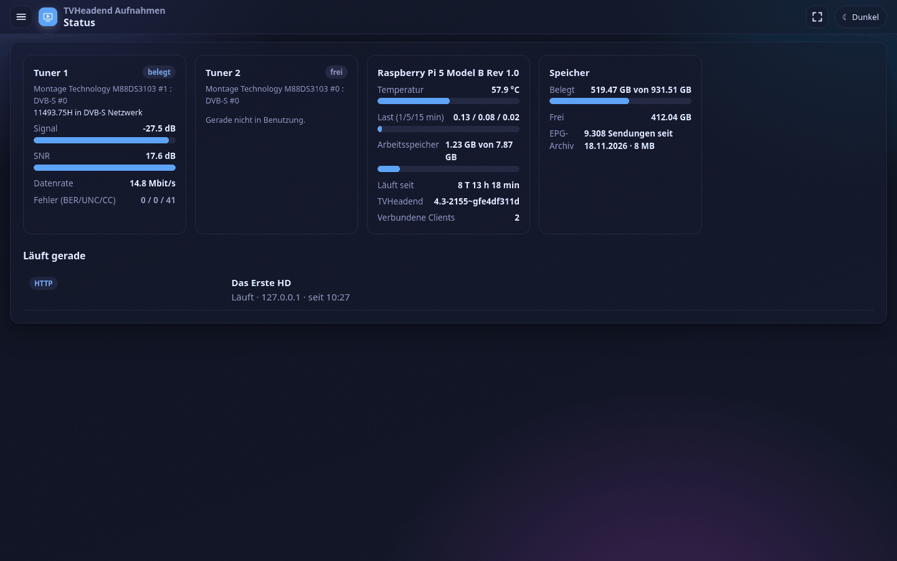
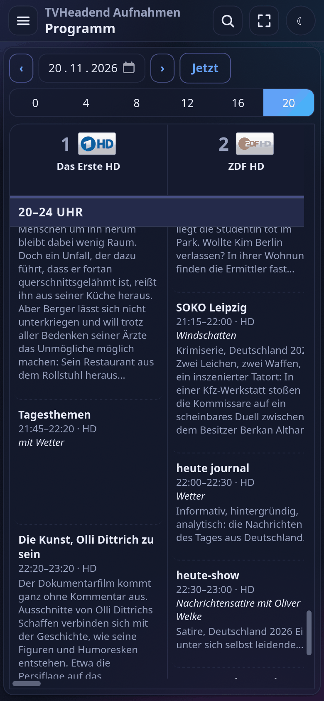
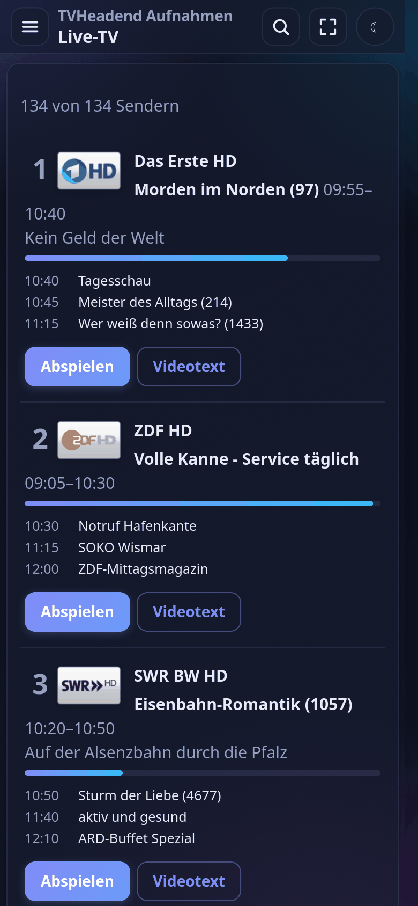

# tvh-aufnahmen

*[Deutsche Fassung](README.md)*

Web interface for Tvheadend 4.3 (German and English, more languages via a JSON file) to

- show the **TV guide** like a printed TV magazine – a whole day, channels as columns, six rows of 4 hours each with all programmes starting in them (if a programme runs past a block boundary, its box, text and image simply continue in the next row; at the start of the day it appears with its title as a continuation); the quick selection jumps to a block – and click a programme to see all EPG details and schedule a recording or a series recording (with all Tvheadend options),
- **search across all days** of the guide (titles, optionally descriptions too); running programmes are highlighted, past ones greyed out,
- **“Tonight”**: per channel the programme at 20:15 and the one after it, with poster, for today and the next six days,
- get a **reminder** for a programme – 5 minutes before it starts an ntfy message arrives; tapping it opens the channel in the player,
- create and fill **channel lists** (favourites); Live TV, TV guide and “Tonight” can show only the channels of one list (stored as channel tags in Tvheadend, so Kodi & co. see them too),
- see the **status**: tuners with signal and errors, running recordings and streams, temperature, load and memory of the computer, plus the **reception history** per transponder (SNR and errors per hour, recordings with errors) – so you can tell whether it is the weather, the dish or a single transponder,
- detect **conflicts** when more recordings on different transponders are scheduled at the same time than there are tuners – and **resolve** them: repeats of the same programme are offered as alternatives, each telling whether enough tuners are free then; one click moves the recording,
- find **duplicate recordings** (“Duplicates” view under Recordings: same title and subtitle, without subtitle the same description) – the HD or error-free, longest version is kept, the others are preselected for deletion,
- **free up space** (“Free up space” view under Recordings): watched and oldest recordings first, with the total and the free space afterwards; the ntfy warning “Disk almost full” leads straight there,
- **resume playback**: the internal player stores the position in Tvheadend (like Kodi) and continues there; watched recordings are marked, started ones get a progress bar,
- **detect ads** (with comskip, in the background): ad breaks appear red on the timeline and can be skipped; for Avidemux there is a project file that loads the downloaded recording without the ad breaks,
- schedule recordings **manually** (channel, title, date, start, end, padding) – button “＋ New recording” in the header of “Recordings” and “Scheduled recordings”,
- manage **series recordings** (create, edit, enable/disable, delete) – with a **preview** of which programmes the rule matches (scheduled, already recorded, warning if there are too many) – and see and delete all **scheduled recordings** individually,
- **Live TV**: show all channels with logo, the current programme (with progress bar) and the next three, and play a channel right in the browser (or externally, e.g. in VLC),
- view a channel’s **teletext** (with colours and block graphics) and show teletext **subtitles** in the player,
- show **recordings** as a list or grouped by folder, sort by name, channel, date, duration or size, search, download, stream in VLC, edit title, subtitle and description, replace the video file (e.g. after cutting) and delete recordings including the file; playback also works directly in the browser,
- register video files in the recording folder that Tvheadend does not know (any more) as recordings again – with title, subtitle, channel, time and description,
- point old entries whose file merely moved to another folder to the new path,
- delete entries whose file no longer exists. Video files are never deleted in the process,
- start a **channel scan**, add new TV channels – language(s) and encryption selectable, numbered after the highest existing number – and delete channels that no longer exist,
- **arrange channels**: all channels as tiles, drag them with the mouse or a finger (or type a number) – the channel gets the number after its new predecessor; if that number is taken, you are asked whether the following channels should move up until the next gap (otherwise the number is used twice and marked red). Gaps in the numbering are shown as a blue line between the tiles. Double-click a channel to delete it or change its number – only within the gap to its neighbours –, after which you are asked whether the directly following channels up to the next gap should move along. Nothing is saved until you press the button,
- keep seeing past days in the guide (permanent **EPG archive**) and find earlier broadcasts of a programme,
- **back up** Tvheadend – completely or just recordings and channels, also automatically every night – and restore it after a reinstall.

## Screenshots

The screenshots show the German interface; the English one looks the same.

**TV guide** – a day as a TV magazine, each row a 4-hour time axis; images for films and series



**Programme** – all details, image, schedule a recording or series recording



**Live TV** – current and next programmes, playback in the browser, teletext





**Recordings** – with thumbnail, playback, editing, duplicate finder



**Status** – tuners, computer, storage, EPG archive



**On the phone**

 

Runs on a Linux computer with Tvheadend (x86 or ARM). Python 3.7+, no additional Python packages; `ffmpeg` is needed for the internal player, subtitles and thumbnails. User names and passwords with umlauts work. The tool runs on the same computer as Tvheadend so that the file paths match – if Tvheadend runs in Docker, the recording folder must have the same path inside the container as on the host.

## Installation

**With the install script** (Debian, Ubuntu, Raspberry Pi OS) – on the Tvheadend machine:

```bash
curl -fsSL https://raw.githubusercontent.com/PerFermat/tvh-aufnahmen/main/install.sh | sudo bash
```

The script finds the user Tvheadend runs as, installs python3, ffmpeg and optionally comskip, downloads the latest release to `~<user>/tvh-aufnahmen`, sets up the systemd service and starts it. Optionally it allows the user to stop and start Tvheadend for restoring a full backup (sudo rule for exactly these two commands). At the end it shows the address of the interface; there, enter the Tvheadend user and password under “Settings”. Running it again updates to the latest release, settings are kept. Options (user, folder, port, version, uninstall): `bash install.sh --help`.

**Manually:** the tool runs on any Linux computer that also runs Tvheadend. Copy the launcher `tvh-aufnahmen.py` and the folder `tvh_aufnahmen` next to it – preferably into the home directory of the user Tvheadend runs as (`<user>`), so the tool may read and write recordings and configuration:

```bash
rsync -a --exclude __pycache__ tvh-aufnahmen.py tvh_aufnahmen <user>@<tvheadend-host>:~/tvh-aufnahmen/
ssh <user>@<tvheadend-host> python3 ~/tvh-aufnahmen/tvh-aufnahmen.py
```

Then open `http://<tvheadend-host>:8099/` in the browser. Under **Settings** you set:

| Field | Default |
|---|---|
| Recording folder | `~/Tvheadend/Extern/Aufnahmen` (if present) |
| Tvheadend server | `http://localhost:9981` |
| User / password | Tvheadend user with admin rights for the recorder |
| Language code | `ger` |
| Tvheadend configuration folder | `~/.config/hts` or `~/.hts/tvheadend` (if present), for the full backup |

The settings are stored in `~/.config/tvh-aufnahmen.json` (readable only by the user). Alternatively, command-line options take precedence over the file:

```bash
python3 tvh-aufnahmen.py --recdir /media/HDD/Recordings --tvh http://localhost:9981 --user admin --port 8099
```

`python3 tvh-aufnahmen.py --help` lists all options.

For ad detection also install comskip (Debian/Ubuntu/Raspberry Pi OS: `sudo apt install comskip`). Without comskip only this feature is missing.

## Running as a service

`/etc/systemd/system/tvh-aufnahmen.service`:

```ini
[Unit]
Description=Tvheadend recordings manager
After=network.target tvheadend.service

[Service]
User=<user>
ExecStart=/usr/bin/python3 /home/<user>/tvh-aufnahmen/tvh-aufnahmen.py
Restart=on-failure

[Install]
WantedBy=multi-user.target
```

```bash
sudo systemctl enable --now tvh-aufnahmen
```

## Desktop shortcut (Linux)

The folder `desktop/` contains a shortcut and an icon. To install them for the start menu:

```bash
install -Dm644 desktop/tvh-aufnahmen.svg ~/.local/share/icons/hicolor/scalable/apps/tvh-aufnahmen.svg
install -Dm755 desktop/tvh-aufnahmen.desktop ~/.local/share/applications/tvh-aufnahmen.desktop
```

Afterwards it can be dragged onto the desktop from the start menu or directly from `desktop/`. It opens the address in the `Exec=` line in the default browser – enter the name or IP address of the Tvheadend host there first.

## Languages

Interface and messages are available in **German** and **English**. The language is chosen per device under “Settings” → “Language”; without a choice the browser language applies. Notifications to the phone use the language chosen last, the console help (`--help`) the language of the environment (`LANG`).

The texts are stored per language in a JSON file under `tvh_aufnahmen/lang/` (`de.json`, `en.json`) – key and text, placeholders in curly braces (`"rec.count": "{n} of {total} recordings"`). `_name` is the name of the language, `_locale` the format for dates and numbers. For another language copy `en.json`, e.g. as `fr.json`, and translate the texts; after a restart it can be selected. Missing texts fall back to German.

## Sign-in (access from outside)

Under “Settings” → “Sign-in” you create users (name and password, at least 8 characters) and choose when sign-in is required:

- **only from outside** (default): devices in the home network get in without sign-in – private IPv4 addresses (also via the router’s VPN), IPv6 ULA and link-local addresses and the IPv6 network of this computer. Everyone else has to sign in. As long as there is no user, nobody gets in from outside.
- **always**: also in the home network (can only be switched while signed in, so you cannot lock yourself out).
- **never**: no sign-in at all – home network only.

Passwords are stored with scrypt, sessions via a cookie (HttpOnly, SameSite=Lax, Secure with HTTPS) and are valid for 30 days. After 5 failed attempts an address is blocked for 15 minutes. Requests from foreign pages (Origin) are rejected. The m3u files for the external player contain signed links valid for 12 hours, because VLC does not send the sign-in cookie. Live TV in the external player streams directly from Tvheadend (port 9981) and only works from outside if Tvheadend is reachable too – the internal player does not need that.

**HTTPS is mandatory**, otherwise passwords travel through the network in plain text. The tool itself only speaks HTTP; put a proxy with a certificate in front of it, e.g. [Caddy](https://caddyserver.com) with Let’s Encrypt (`/etc/caddy/Caddyfile`, forward ports 80 and 443 on the router to the computer):

```
mytv.example.com {
    reverse_proxy localhost:8099
}
```

The proxy must pass on the original host (`Host` or `X-Forwarded-Host`), the client address (`X-Forwarded-For`) and `X-Forwarded-Proto` – Caddy does this by itself, with nginx set `proxy_set_header` for all three. If the proxy runs on the same computer, the address from `X-Forwarded-For` counts (otherwise every request would look like one from the home network); the option `--bind 127.0.0.1` then makes sure nobody can bypass the proxy and access port 8099 directly.

**Proxy on another server** (e.g. a rented server with nginx that reaches the computer at home through a WireGuard tunnel – this works without port forwarding and with DS-Lite too): its tunnel address is private and would look like the home network. It therefore belongs in the configuration file as a trusted proxy, e.g. `"trusted_proxies": ["10.77.0.1"]` – then the client from `X-Forwarded-For` counts, and the proxy itself never counts as home network. The matching nginx block: `proxy_pass http://<tunnel-address>:8099;` with `proxy_set_header` for `Host`, `X-Forwarded-Host`, `X-Forwarded-For $remote_addr` and `X-Forwarded-Proto https`, plus `proxy_buffering off`, `proxy_request_buffering off`, `client_max_body_size 0` and long `proxy_read_timeout` values for streams and uploads. On the computer at home, the firewall should only let port 8099 through the tunnel.

## Ads and Avidemux

If comskip is installed, the tool examines new recordings of the last 30 days in the background – at the lowest priority and only one at a time; older ones on request via “Find ads” in a recording’s detail window. The recordings themselves stay untouched, the results are stored in `~/.cache/tvh-aufnahmen/werbung/`. Under Settings → “Detect ads” you choose: automatic, only on request, or off (then nothing is shown either). There you can also shift the start and end of the ad breaks by a few seconds – for channels that hide their logo before the ads or show a programme trailer with logo after them. The shift applies immediately to all recordings, including those already examined.

In the internal player the ad breaks are red on the timeline; with “Skip ads” it jumps to the end of a break when reaching it.

**Avidemux:** in a recording’s detail window, “Avidemux project” downloads a project file (`<recording>.ts.py`). Before that the tool asks in which folder the downloaded recording lies on the PC (e.g. `/home/name/Downloads`) – it remembers this. Open it in Avidemux via **File → Project Script → Run Project**: the recording appears without the ad breaks (as segments; the cuts are visible on the timeline and can be adjusted), video and audio are only copied when saving. The cuts lie on keyframes, so Avidemux saves in copy mode without asking. The `.idx2` file, on the other hand, is just Avidemux’s own index, which it creates itself the first time a `.ts` file is opened – marks cannot be stored in it.

comskip detects ads by black frames, the missing channel logo, silence and format changes. With German private channels the ads are often not separated by black frames – then everything depends on the logo, and detection is not always exact. So check the breaks before the final cut.

## Backup

The **Backup** tab offers two ways:

**Full backup** – downloads Tvheadend’s whole configuration folder as `.tar.gz` (a few MB). When restoring, the tool stops Tvheadend (`sudo -n systemctl stop tvheadend`), renames the current folder to `<folder>.vor-wiederherstellung-<time>`, unpacks the backup and starts Tvheadend again. Afterwards everything is exactly as before, with the same IDs – including watched status and playback position in Kodi, series timers, tuners and users. Requirement: same hardware and the same or a newer Tvheadend version (with a different version the tool asks). Because the backup contains Tvheadend’s users and passwords, the download asks for the password from the settings. If the user may not run `sudo` without a password, the tool changes nothing and shows the commands for a manual restore. With `--tvh-service ''` the tool never touches the service.

**Recordings and channels (JSON)** – for different hardware, a different version or a different recording folder. Exports channel tags, channels (number, tags, services with network, transponder and service ID), series timers and all recordings with a file. The import first shows a preview (new / adjust / exists / service not found) and only creates things after confirmation – in the order tags, channels, timers, recordings. Paths under the old recording folder are rewritten to the current one. Recordings get new IDs in the process.

Recommended procedure after a reinstall:

1. Install Tvheadend and start it once, then install this tool.
2. Restore the full backup – done.
3. If that is not possible (different hardware/version): set up the tuners in Tvheadend and run a scan, then import the JSON file.

## Structure

| File | Content |
|---|---|
| `tvh-aufnahmen.py` | Launcher, calls `tvh_aufnahmen.cli.main()` (alternatively `python3 -m tvh_aufnahmen`) |
| `tvh_aufnahmen/cli.py` | Command-line options, starts the server |
| `tvh_aufnahmen/config.py` | Load, check and save settings |
| `tvh_aufnahmen/tvh.py` | Access to the Tvheadend API (digest login with UTF-8) |
| `tvh_aufnahmen/files.py` | Find video files, guess title and times from the file name |
| `tvh_aufnahmen/live.py` | Live TV: channels with programme data, stream playlist, channel logos |
| `tvh_aufnahmen/epg.py` | TV guide, scheduling, series recordings, scheduled recordings, forms from the Tvheadend classes |
| `tvh_aufnahmen/epg_archive.py` | Permanent archive of past programmes (SQLite, compressed) |
| `tvh_aufnahmen/player.py` | Internal player: live TV and recordings via ffmpeg as H.264/AAC MPEG-TS for the browser |
| `tvh_aufnahmen/teletext.py` | Teletext: reads the teletext packets from the channel stream and assembles the pages |
| `tvh_aufnahmen/posters.py` | Images for long programmes from Wikipedia, TVmaze (series) and Trakt, searched in the background and cached |
| `tvh_aufnahmen/scan.py` | Channel scan, evaluation, add new channels, delete vanished ones |
| `tvh_aufnahmen/channels.py` | Arrange channels: channel list, check and save new numbers, channel lists (tags) |
| `tvh_aufnahmen/reception.py` | Reception history: per-minute measurement of the working tuners (SQLite) and recording errors per transponder |
| `tvh_aufnahmen/ads.py` | Ad detection: comskip in the background, ad breaks per recording |
| `tvh_aufnahmen/status.py` | Status page: tuners, running recordings and streams, computer |
| `tvh_aufnahmen/thumbs.py` | Recording thumbnails via ffmpeg |
| `tvh_aufnahmen/jobs.py` | Background tasks: nightly backup, notifications and reminders via ntfy, reception measurement, ad search |
| `tvh_aufnahmen/state.py` | Matching entries ↔ files: recordings, unregistered files, entries without file |
| `tvh_aufnahmen/recordings.py` | Changes: import, edit, replace file, delete, repair paths |
| `tvh_aufnahmen/backup.py` | Full backup of the Tvheadend folder and restore |
| `tvh_aufnahmen/transfer.py` | JSON export/import of tags, channels, series timers and recordings |
| `tvh_aufnahmen/server.py` | HTTP routes, download, playlist, serving the interface |
| `tvh_aufnahmen/auth.py` | Sign-in: users, passwords (scrypt), sessions, home network detection, lockout after failed attempts, signed links |
| `tvh_aufnahmen/i18n.py` | Languages: texts from `lang/*.json`, language per request (cookie or browser) |
| `tvh_aufnahmen/lang/` | Language files `de.json`, `en.json` |
| `tvh_aufnahmen/static/` | Interface: `index.html`, `style.css` and one JavaScript file per tab (`common.js` for shared code) |

New features get their logic in `recordings.py` (or a module of their own), a route in `server.py` and the controls in the matching script under `static/`. Never hard-code visible texts; put them as keys into `lang/de.json` and `lang/en.json` – in the browser `L('key', {n: 3})`, in the server `_('key', n=3)`. Code comments are in German.

## Notes

- Reachability: the default is `::` (IPv6 and IPv4); with `--bind 127.0.0.1` the interface is only reachable on the computer itself (e.g. behind a proxy). Access from outside: see “Sign-in”.
- Start and end time are guessed from the file name (e.g. `Tatort-2023-05-14-20-15.ts`) and the modification time. If `ffprobe` is installed (`sudo apt install ffmpeg`), the real duration is used.
- Without a channel Tvheadend does not create an entry. The tool suggests the channel of other recordings in the same folder, otherwise “Unknown”.
- The end of a recording must lie in the past, otherwise Tvheadend would create a recording timer. The tool prevents that.
- Playback: under “Settings” you choose per device the **internal player** (default) or the external one. The internal one plays live TV and recordings right in the browser (mpegts.js, included under `static/vendor/`, Apache-2.0). For that the tool delivers MPEG-TS with H.264 video and AAC audio via ffmpeg: H.264 in quality “Home” is only remuxed (hardly any load), MPEG-2 channels and lower qualities are transcoded (at most two at a time; a small computer usually manages only one transcode in real time). Recordings seek via a timeline of their own. Works in Chrome, Firefox, Edge and on Android – not on the iPhone (the external player is used there automatically). The external player downloads a small `.m3u` file. Opened with VLC (or another player), it streams the recording from the tool; seeking works. The browser itself cannot play `.ts` recordings.
- Teletext: in the live player and in the programme details, “Teletext” opens the channel’s teletext pages with colours and block graphics. Browse with ◀/▶ (arrow keys), type page numbers or click a page number in the text; “?” reveals hidden text. Text can be selected and copied with the mouse, “Copy” takes the whole page. Reading it briefly occupies a tuner and ends 45 seconds after closing.
- Subtitles: the button “Subtitles: on/off” in the internal player shows the teletext subtitles (page 150/777), live and for recordings that recorded the teletext. ffmpeg reads them alongside (`~/.cache/tvh-aufnahmen/subs`, deleted after playback). The device remembers the setting.
- Replace file: the uploaded file overwrites the old one. If it has a different extension (e.g. `.mkv` instead of `.ts`), the recording is switched to the new file and the old one is deleted. Start and end of finished recordings cannot be changed in Tvheadend 4.3.
- Edit description: Tvheadend 4.3 does not allow this directly for finished recordings. The tool therefore recreates the entry with the new description; the video file stays unchanged, but the entry gets a new ID.
- Playing live TV externally: the `.m3u` file comes from Tvheadend and contains a one-time ticket instead of the password that is only valid briefly – so open the file right away. It streams directly from Tvheadend (port 9981), unchanged as received. Anyone who can reach the interface can play channels this way.
- The series recording form is generated from Tvheadend’s class description (`api/idnode/class`) and therefore shows all options of the installed version; rarely used ones are under “More options”.
- TV guide: each row is a 4-hour time axis – programmes stand at the position of their time, so simultaneous programmes are side by side; a programme’s box reaches to the next one. If a channel has many programmes, descriptions are dropped, long programmes get more text. Full cells show 10 programmes, always including the running one (“+ n earlier” / “+ n more” expand). For programmes of 80 minutes or more the server searches an image in the background; when a programme is opened in the detail window, also for shorter ones (then with priority, shown only there). It searches the German Wikipedia article – only with an exactly matching title and a short description as film, series, programme or similar; for articles with the same name the year from the EPG counts (“Drama, USA 2005”). The image comes from the German article, otherwise the English one (which has film posters), otherwise from Wikidata. If Wikipedia finds nothing or only a Wikidata logo, [TVmaze](https://www.tvmaze.com) is searched for a series of the same name (no account needed; episode numbers and appended episode titles are dropped). If a Trakt Client ID is entered under “Settings” (free: account on trakt.tv, create an app under Applications with redirect URI `urn:ietf:wg:oauth:2.0:oob`), [Trakt](https://trakt.tv) is searched last for a film or series – German titles are found via Trakt’s translations; for films the year must match. The Client ID is only stored in the configuration file. At most one request per second; the results are kept in `~/.cache/tvh-aufnahmen/posters.json`, the browser loads the images directly from Wikimedia, TVmaze or Trakt.
- Channel scan: all TV services without a channel that were seen during the scan are evaluated. Which ones are shown is chosen afterwards: encryption (free-to-air / encrypted / all) and language of the first audio track (“All languages” or tick individual ones – the languages found are offered with their count; the device remembers the choice). Test channels and leftovers (“Astra Demo”, “ALT_…”) are left out; SD, regional and country versions of existing channels, services without a language and adult channels are listed separately and not preselected. A channel counts as vanished if its services were not seen for at least two days before the scan (Tvheadend updates “last seen” only coarsely), if Tvheadend disabled them as “missing in PAT/SDT”, or if they are only listed in the PAT with a placeholder name (“Service <number>”, no entry in the service directory) – discontinued channels often remain like this. When adding, disabled services are enabled. When channels are deleted and a transponder is left without any channel, EPG reading is switched off there – foreign transponders also transmit programme data for other channels and could overwrite them.
- Programme archive: Tvheadend deletes programmes from the EPG as soon as they are over. The tool therefore stores running and upcoming programmes every 10 minutes in `~/.cache/tvh-aufnahmen/epg-archiv` (SQLite database `epg.sqlite`, permanent), so the guide shows past days too. A programme is identified by channel and start time; the details are stored compressed, and only changes are written (spares the SD card). About 1–1.5 MB per day for around 130 channels, so a little over 500 MB a year; count and size are shown under “Status”. “Find repeats” also shows earlier broadcasts from the archive. Day files from older versions are imported once at startup. The nightly backup puts a copy of the archive as `epg-archiv.sqlite` into the backup folder (only one, replaced every night); “Complete the archive from the copy” in the “Backup” tab restores missing programmes from it, e.g. after replacing the SD card.
- Storage: usage, free space and a warning if recordings failed because the disk was full are shown in the “Status” tab. Every recording gets a thumbnail (still image 20 minutes after the start, from the middle for short recordings, via ffmpeg, cached in `~/.cache/tvh-aufnahmen/thumbs`).
- Automatic backup: every night (default 03:30, adjustable in the “Backup” tab) a full backup without programme data and the JSON export, by default to `<disk>/Backup/tvheadend-sicherungen`; the last 14 are kept. If the time is missed (computer off), it is caught up. Plus a copy of the EPG archive (see above). The backup contains Tvheadend’s passwords – so the folder should not be shared with others.
- Notifications (Settings): via [ntfy](https://ntfy.sh) for finished and failed recordings and when less than 10 % of the disk is free. If the address of the interface is entered there, tapping a message opens the matching place.
- As an app: the interface has a web app manifest. On the iPhone use “Share → Add to Home Screen” for an app of its own without browser bar; on Android “Add to Home screen” creates a shortcut (a real app with its own window only via HTTPS).
- Playback quality: selectable under “Settings”, per device. Besides “Home” (original) the interface offers the lower levels from `QUALITIES` in `live.py` – but only if Tvheadend has a stream profile with that name (for the external player; the internal one transcodes with ffmpeg itself).
- Responses are gzip-compressed; downloads support HTTP range requests, so players can seek.
- Before the first big import, back up the folder `~/.hts/tvheadend/dvr/log`.

## License

Copyright (C) 2026 PerFermat

This program is free software: you can redistribute it and/or modify it under the terms of the [GNU General Public License](LICENSE), version 3 (GPL-3.0) – like Tvheadend itself. Anyone distributing a modified version must also distribute it under the GPL-3.0 with source code. The program is provided without any warranty.

Included under `tvh_aufnahmen/static/vendor/`: [mpegts.js](https://github.com/xqq/mpegts.js) (Apache-2.0).
