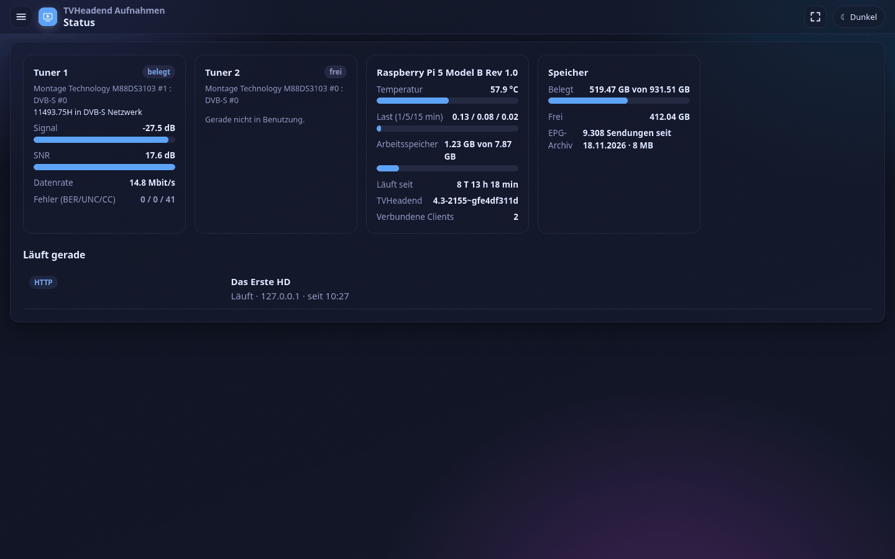

# tvh-aufnahmen

Web-Oberfläche für TVHeadend 4.3 (deutsch und englisch, weitere Sprachen als JSON-Datei), um

- das **Programm** wie eine Fernsehzeitschrift zu zeigen – ein ganzer Tag, Sender als Spalten, sechs Zeilen zu je 4 Stunden mit allen Sendungen, die darin beginnen; die Schnellauswahl springt zum Block – und per Klick auf eine Sendung alle EPG-Angaben zu sehen, eine Aufnahme oder eine Serienaufnahme (mit allen Optionen von TVHeadend) zu planen,
- im Programm **über alle Tage zu suchen** (Titel, auf Wunsch auch Beschreibungen); laufende Sendungen sind markiert, vorbeigelaufene grau,
- **„Heute Abend“**: je Sender die Sendung um 20:15 und die danach, mit Plakat, für heute und die nächsten sechs Tage,
- sich an eine Sendung **erinnern** zu lassen – 5 Minuten vor Beginn kommt eine ntfy-Nachricht; Antippen öffnet den Sender im Player,
- **Senderlisten** (Favoriten) anzulegen und zu füllen; Live-TV, Programm und „Heute Abend“ zeigen auf Wunsch nur die Sender einer Liste (gespeichert als Sender-Tags in TVHeadend, Kodi & Co. sehen sie also auch),
- den **Status** zu sehen: Tuner mit Signal und Fehlern, laufende Aufnahmen und Streams, Temperatur, Last und Speicher des Rechners, dazu den **Empfangsverlauf** je Transponder (SNR und Fehler je Stunde, Aufnahmen mit Fehlern) – so sieht man, ob es am Wetter, an der Schüssel oder an einem Transponder liegt,
- **Konflikte** zu erkennen, wenn mehr Aufnahmen gleichzeitig auf verschiedenen Transpondern geplant sind, als es Tuner gibt – und sie zu **lösen**: Wiederholungen derselben Sendung werden als Ausweichtermin angeboten, jeweils mit der Angabe, ob dort genug Tuner frei sind; ein Klick verlegt die Aufnahme,
- **doppelte Aufnahmen** zu finden (Ansicht „Doppelte“ bei Aufnahmen: gleicher Titel und Untertitel, ohne Untertitel gleiche Beschreibung) – behalten wird die HD- bzw. fehlerfreie, längste Fassung, die übrigen sind zum Löschen vorausgewählt,
- **Platz zu schaffen** (Ansicht „Platz schaffen“ bei Aufnahmen): angesehene und älteste Aufnahmen zuerst, mit Summe und freiem Platz danach; die ntfy-Warnung „Platte fast voll“ führt direkt dorthin,
- **weiterzuschauen**: Der interne Player merkt sich den Stand in TVHeadend (wie Kodi) und macht dort weiter; angesehene Aufnahmen sind markiert, angefangene haben einen Fortschrittsbalken,
- **Werbung zu erkennen** (mit comskip, im Hintergrund): Werbeblöcke erscheinen rot auf der Zeitleiste und werden auf Wunsch übersprungen; für Avidemux gibt es eine Projektdatei, die die heruntergeladene Aufnahme ohne die Werbeblöcke lädt,
- Aufnahmen **von Hand** zu planen (Sender, Titel, Datum, Beginn, Ende, Vor-/Nachlauf) – Knopf „＋ Neue Aufnahme“ im Kopf bei „Aufnahmen“ und „Geplante Aufnahmen“,
- **Serienaufnahmen** zu verwalten (anlegen, bearbeiten, aktivieren/deaktivieren, löschen) – mit **Vorschau**, welche Sendungen die Regel trifft (geplant, schon aufgenommen, Warnung bei zu vielen) – und alle **geplanten Aufnahmen** einzeln zu sehen und zu löschen,
- **Live-TV**: alle Sender mit Logo, der laufenden Sendung (mit Fortschrittsbalken) und den nächsten drei Sendungen anzuzeigen und einen Sender direkt im Browser abzuspielen (oder extern, z. B. in VLC),
- den **Videotext** eines Senders anzusehen (mit Farben und Blockgrafik) und Videotext-**Untertitel** im Player einzublenden,
- **Aufnahmen** als Liste oder nach Ordnern gruppiert anzuzeigen, nach Name, Sender, Datum, Dauer oder Größe zu sortieren, zu durchsuchen, herunterzuladen, in VLC als Stream abzuspielen, Titel, Untertitel und Beschreibung zu ändern, die Videodatei zu ersetzen (z. B. nach dem Schneiden) und Aufnahmen samt Datei zu löschen; abgespielt wird ebenfalls direkt im Browser,
- Videodateien aus dem Aufnahmeordner, die TVHeadend nicht (mehr) kennt, wieder als Aufnahme einzutragen – mit Titel, Untertitel, Sender, Zeit und Beschreibung,
- alte Einträge, deren Datei nur in einen anderen Ordner gewandert ist, auf den neuen Pfad umzustellen,
- Einträge zu löschen, deren Datei nicht mehr existiert. Videodateien werden dabei nie gelöscht,
- einen **Sendersuchlauf** zu starten, neue Fernsehsender anzulegen – Sprache(n) und Verschlüsselung wählbar, fortlaufend nach der höchsten Nummer – und Sender zu löschen, die es nicht mehr gibt,
- die **Sender zu ordnen**: alle Sender als Kacheln, mit der Maus oder dem Finger verschieben (oder Nummer eintippen) – der Sender bekommt die Nummer nach seinem neuen Vorgänger; ist sie schon vergeben, fragt das Programm, ob die folgenden Sender bis zur nächsten Lücke aufrücken sollen (sonst ist die Nummer doppelt und wird rot markiert). Lücken in der Nummerierung zeigt ein blauer Strich zwischen den Kacheln. Per Doppelklick lässt sich ein Sender löschen oder seine Nummer ändern – nur innerhalb der Lücke zu den Nachbarn –, danach fragt das Programm, ob die direkt folgenden Sender bis zur nächsten Lücke mitgehen. Gespeichert wird erst auf Knopfdruck,
- vergangene Tage im Programm weiter zu sehen (dauerhaftes **EPG-Archiv**) und frühere Ausstrahlungen einer Sendung zu finden,
- TVHeadend zu **sichern** – komplett oder gezielt Aufnahmen und Sender, auch automatisch jede Nacht – und nach einer Neuinstallation wiederherzustellen.

## Bildschirmfotos

**Programm** – ein Tag als Fernsehzeitschrift, jede Zeile eine Zeitachse über 4 Stunden; Bilder zu Filmen und Serien


**Sendung** – alle Angaben, Bild, Aufnahme oder Serienaufnahme planen


**Live-TV** – laufende und nächste Sendungen, Abspielen im Browser, Videotext


**Aufnahmen** – mit Vorschaubild, Abspielen, Bearbeiten, Doppelte finden


**Status** – Tuner, Rechner, Speicher, EPG-Archiv



**Auf dem Handy**

 

Läuft auf einem Linux-Rechner mit TVHeadend (x86 oder ARM). Python 3.7+, keine zusätzlichen Python-Pakete; für internen Player, Untertitel und Vorschaubilder wird `ffmpeg` gebraucht. Benutzer und Passwörter mit Umlauten funktionieren. Das Tool läuft auf demselben Rechner wie TVHeadend, damit die Dateipfade übereinstimmen – läuft TVHeadend in Docker, muss der Aufnahmeordner im Container unter demselben Pfad liegen wie auf dem Rechner.

## Installation

Das Tool läuft auf jedem Linux-Rechner, auf dem auch TVHeadend läuft. Kopiert werden der Starter `tvh-aufnahmen.py` und der Ordner `tvh_aufnahmen` daneben – am besten ins Home-Verzeichnis des Benutzers, unter dem TVHeadend läuft (`<benutzer>`), damit das Tool Aufnahmen und Konfiguration lesen und schreiben darf:

```bash
rsync -a --exclude __pycache__ tvh-aufnahmen.py tvh_aufnahmen <benutzer>@<tvheadend-rechner>:~/tvh-aufnahmen/
ssh <benutzer>@<tvheadend-rechner> python3 ~/tvh-aufnahmen/tvh-aufnahmen.py
```

Dann im Browser `http://<tvheadend-rechner>:8099/` öffnen. Unter **Einstellungen** stellst du ein:

| Feld | Standard |
|---|---|
| Aufnahmeverzeichnis | `~/Tvheadend/Extern/Aufnahmen` (wenn vorhanden) |
| TVHeadend-Server | `http://localhost:9981` |
| Benutzer / Passwort | TVHeadend-Benutzer mit Admin-Rechten für den Rekorder |
| Sprachcode | `ger` |
| TVHeadend-Konfigurationsordner | `~/.config/hts` oder `~/.hts/tvheadend` (wenn vorhanden), für die Komplettsicherung |

Die Einstellungen landen in `~/.config/tvh-aufnahmen.json` (nur für den Benutzer lesbar). Alternativ gehen Startparameter, die Vorrang vor der Datei haben:

```bash
python3 tvh-aufnahmen.py --recdir /media/HDD/Aufnahmen --tvh http://localhost:9981 --user admin --port 8099
```

`python3 tvh-aufnahmen.py --help` zeigt alle Optionen.

Für die Werbeerkennung zusätzlich comskip installieren (Debian/Ubuntu/Raspberry Pi OS: `sudo apt install comskip`). Ohne comskip fehlt nur diese Funktion.

## Dauerhaft als Dienst

`/etc/systemd/system/tvh-aufnahmen.service`:

```ini
[Unit]
Description=TVHeadend Aufnahmen-Verwaltung
After=network.target tvheadend.service

[Service]
User=<benutzer>
ExecStart=/usr/bin/python3 /home/<benutzer>/tvh-aufnahmen/tvh-aufnahmen.py
Restart=on-failure

[Install]
WantedBy=multi-user.target
```

```bash
sudo systemctl enable --now tvh-aufnahmen
```

## Desktop-Verknüpfung (Linux)

Im Ordner `desktop/` liegen eine Verknüpfung und ein Icon. Installieren fürs Startmenü:

```bash
install -Dm644 desktop/tvh-aufnahmen.svg ~/.local/share/icons/hicolor/scalable/apps/tvh-aufnahmen.svg
install -Dm755 desktop/tvh-aufnahmen.desktop ~/.local/share/applications/tvh-aufnahmen.desktop
```

Danach lässt sie sich aus dem Startmenü oder direkt aus `desktop/` auf den Schreibtisch ziehen. Sie öffnet die Adresse aus der Zeile `Exec=` im Standardbrowser – dort vorher den Namen oder die IP-Adresse des TVHeadend-Rechners eintragen.

## Sprachen

Oberfläche und Meldungen gibt es auf **Deutsch** und **Englisch**. Die Sprache wählt man je Gerät unter „Einstellungen“ → „Sprache“; ohne Wahl gilt die Sprache des Browsers. Benachrichtigungen aufs Handy kommen in der zuletzt gewählten Sprache, die Hilfe auf der Konsole (`--help`) in der Sprache der Umgebung (`LANG`).

Die Texte liegen je Sprache in einer JSON-Datei unter `tvh_aufnahmen/lang/` (`de.json`, `en.json`) – Schlüssel und Text, Platzhalter in geschweiften Klammern (`"rec.count": "{n} von {total} Aufnahmen"`). `_name` ist der Name der Sprache, `_locale` das Format für Datum und Zahlen. Für eine weitere Sprache `de.json` kopieren, z. B. als `fr.json`, und die Texte übersetzen; nach einem Neustart steht sie zur Auswahl. Fehlt ein Text, gilt der deutsche.

## Anmeldung (Zugriff von außen)

Unter „Einstellungen“ → „Anmeldung“ legt man Benutzer an (Name und Passwort, mindestens 8 Zeichen) und wählt, wann eine Anmeldung nötig ist:

- **nur von außen** (Standard): Geräte im Heimnetz kommen ohne Anmeldung herein – private IPv4-Adressen (auch über das VPN der Fritzbox), IPv6-ULA- und Link-Local-Adressen sowie das IPv6-Netz dieses Rechners. Alle anderen müssen sich anmelden. Solange es keinen Benutzer gibt, kommt von außen niemand herein.
- **immer**: auch im Heimnetz (umstellen geht nur angemeldet, damit man sich nicht aussperrt).
- **nie**: ohne jede Anmeldung – nur fürs Heimnetz.

Passwörter werden mit scrypt gespeichert, Sitzungen über ein Cookie (HttpOnly, SameSite=Lax, bei HTTPS Secure) und gelten 30 Tage. Nach 5 Fehlversuchen ist eine Adresse 15 Minuten gesperrt. Anfragen von fremden Seiten (Origin) werden abgelehnt. Die m3u-Dateien für den externen Player enthalten signierte Links, die 12 Stunden gelten, weil VLC kein Anmelde-Cookie mitschickt. Live-TV im externen Player streamt direkt von TVHeadend (Port 9981) und geht von außen nur, wenn auch TVHeadend erreichbar ist – der interne Player braucht das nicht.

**HTTPS ist Pflicht**, sonst gehen Passwörter im Klartext durchs Netz. Das Tool selbst spricht nur HTTP; davor gehört ein Proxy mit Zertifikat, z. B. [Caddy](https://caddyserver.com) mit Let's Encrypt (`/etc/caddy/Caddyfile`, Port 80 und 443 an der Fritzbox auf den Rechner freigeben):

```
meintv.example.de {
    reverse_proxy localhost:8099
}
```

Der Proxy muss den ursprünglichen Host (`Host` oder `X-Forwarded-Host`), die Absenderadresse (`X-Forwarded-For`) und `X-Forwarded-Proto` weitergeben – Caddy tut das von selbst, bei nginx `proxy_set_header` für alle drei setzen. Läuft der Proxy auf demselben Rechner, gilt die Adresse aus `X-Forwarded-For` (sonst sähe jeder Zugriff wie einer aus dem Heimnetz aus); Startparameter `--bind 127.0.0.1` sorgt dann dafür, dass niemand am Proxy vorbei direkt auf Port 8099 zugreift.

**Proxy auf einem anderen Server** (z. B. ein gemieteter Server mit nginx, der den Rechner zu Hause über einen WireGuard-Tunnel erreicht – das geht auch ohne Portfreigabe und bei DS-Lite): Dessen Tunneladresse ist privat und sähe wie das Heimnetz aus. Sie gehört deshalb in die Konfigurationsdatei als vertrauenswürdiger Proxy, z. B. `"trusted_proxies": ["10.77.0.1"]` – dann zählt der Absender aus `X-Forwarded-For`, und der Proxy selbst gilt nie als Heimnetz. Der nginx-Block dazu: `proxy_pass http://<tunneladresse>:8099;` mit `proxy_set_header` für `Host`, `X-Forwarded-Host`, `X-Forwarded-For $remote_addr` und `X-Forwarded-Proto https`, außerdem `proxy_buffering off`, `proxy_request_buffering off`, `client_max_body_size 0` und lange `proxy_read_timeout` für Streams und Uploads. Auf dem Rechner zu Hause sollte die Firewall durch den Tunnel nur Port 8099 durchlassen.

## Werbung und Avidemux

Ist comskip installiert, untersucht das Tool neue Aufnahmen der letzten 30 Tage im Hintergrund – mit niedrigster Priorität und immer nur eine zugleich; ältere auf Wunsch über „Werbung suchen“ im Detailfenster einer Aufnahme. Die Aufnahmen selbst bleiben unverändert, die Ergebnisse liegen in `~/.cache/tvh-aufnahmen/werbung/`. Abschalten lässt es sich unter Einstellungen → „Werbung erkennen“.

Im internen Player sind die Werbeblöcke rot auf der Zeitleiste; mit „Werbung überspringen“ springt er beim Erreichen eines Blocks an dessen Ende.

**Avidemux:** Im Detailfenster einer Aufnahme lädt „Avidemux-Projekt“ eine Projektdatei (`<aufnahme>.ts.py`) herunter. Vorher fragt das Tool, in welchem Ordner die heruntergeladene Aufnahme auf dem PC liegt (z. B. `/home/name/Downloads`) – das merkt es sich. In Avidemux über **Datei → Projektskript → Ausführen** öffnen: Die Aufnahme erscheint ohne die Werbeblöcke (als Abschnitte, die Schnittstellen sind auf der Zeitleiste zu sehen und lassen sich nachbessern), Video und Ton werden beim Speichern nur kopiert. Die `.idx2`-Datei ist dagegen nur Avidemux' eigener Index, den es beim ersten Öffnen einer `.ts`-Datei selbst anlegt – Marken lassen sich darin nicht ablegen.

comskip erkennt Werbung an schwarzen Bildern, am fehlenden Senderlogo, an Tonpausen und Formatwechseln. Bei deutschen Privatsendern trennen oft keine schwarzen Bilder die Werbung – dann hängt alles am Logo, und die Erkennung ist nicht immer genau. Die Blöcke deshalb vor dem endgültigen Schneiden ansehen.

## Sicherung

Der Reiter **Sicherung** bietet zwei Wege:

**Komplettsicherung** – lädt den ganzen Konfigurationsordner von TVHeadend als `.tar.gz` (einige MB). Beim Einspielen stoppt das Tool TVHeadend (`sudo -n systemctl stop tvheadend`), benennt den bisherigen Ordner in `<ordner>.vor-wiederherstellung-<zeit>` um, entpackt die Sicherung und startet TVHeadend wieder. Danach ist alles exakt wie vorher, mit denselben IDs – auch Gesehen-Status und Wiedergabeposition in Kodi, Serien-Timer, Tuner und Benutzer. Voraussetzung: gleiche Hardware und gleiche oder neuere TVHeadend-Version (bei abweichender Version fragt das Tool nach). Weil die Sicherung die TVHeadend-Benutzer und -Passwörter enthält, fragt der Download das Passwort aus den Einstellungen ab. Darf der Benutzer kein `sudo` ohne Passwort, ändert das Tool nichts und zeigt die Befehle für die Wiederherstellung von Hand. Mit `--tvh-service ''` fasst das Tool den Dienst nie an.

**Aufnahmen und Sender (JSON)** – für andere Hardware, eine andere Version oder einen anderen Aufnahmeordner. Exportiert Sender-Tags, Sender (Nummer, Tags, Dienste mit Netzwerk, Transponder und Service-ID), Serien-Timer und alle Aufnahmen mit Datei. Der Import zeigt zuerst eine Vorschau (neu / anpassen / vorhanden / Dienst nicht gefunden) und legt erst nach Bestätigung an – in der Reihenfolge Tags, Sender, Timer, Aufnahmen. Pfade unter dem alten Aufnahmeordner werden auf den aktuellen umgeschrieben. Aufnahmen bekommen dabei neue IDs.

Empfohlener Ablauf nach einer Neuinstallation:

1. TVHeadend installieren und einmal starten, dann dieses Tool installieren.
2. Komplettsicherung einspielen – fertig.
3. Geht das nicht (andere Hardware/Version): in TVHeadend Tuner einrichten und Suchlauf machen, dann die JSON-Datei importieren.

## Aufbau

| Datei | Inhalt |
|---|---|
| `tvh-aufnahmen.py` | Starter, ruft `tvh_aufnahmen.cli.main()` auf (alternativ `python3 -m tvh_aufnahmen`) |
| `tvh_aufnahmen/cli.py` | Startparameter, Server starten |
| `tvh_aufnahmen/config.py` | Einstellungen laden, prüfen, speichern |
| `tvh_aufnahmen/tvh.py` | Zugriff auf die TVHeadend-API (Digest-Login mit UTF-8) |
| `tvh_aufnahmen/files.py` | Videodateien finden, Titel und Zeiten aus dem Dateinamen raten |
| `tvh_aufnahmen/live.py` | Live-TV: Sender mit Programmdaten, Stream-Playlist, Senderlogos |
| `tvh_aufnahmen/epg.py` | Programmzeitschrift, Aufnahmen planen, Serienaufnahmen, geplante Aufnahmen, Formulare aus den TVHeadend-Klassen |
| `tvh_aufnahmen/epg_archive.py` | Dauerhaftes Archiv vergangener Sendungen (SQLite, gepackt) |
| `tvh_aufnahmen/player.py` | Interner Player: Live-TV und Aufnahmen per ffmpeg als H.264/AAC-MPEG-TS für den Browser |
| `tvh_aufnahmen/teletext.py` | Videotext: liest die Videotext-Pakete aus dem Senderstream und setzt die Seiten zusammen |
| `tvh_aufnahmen/posters.py` | Bilder zu langen Sendungen aus der Wikipedia, von TVmaze (Serien) und Trakt, im Hintergrund gesucht und zwischengespeichert |
| `tvh_aufnahmen/scan.py` | Sendersuchlauf, Auswertung, neue Sender anlegen, verschwundene löschen |
| `tvh_aufnahmen/channels.py` | Sender ordnen: Senderliste, neue Nummern prüfen und speichern, Senderlisten (Tags) |
| `tvh_aufnahmen/reception.py` | Empfangsverlauf: minütliche Messung der arbeitenden Tuner (SQLite) und Fehler der Aufnahmen je Transponder |
| `tvh_aufnahmen/ads.py` | Werbung erkennen: comskip im Hintergrund, Werbeblöcke je Aufnahme |
| `tvh_aufnahmen/status.py` | Status-Seite: Tuner, laufende Aufnahmen und Streams, Rechner |
| `tvh_aufnahmen/thumbs.py` | Vorschaubilder der Aufnahmen per ffmpeg |
| `tvh_aufnahmen/jobs.py` | Hintergrundaufgaben: nächtliche Sicherung, Benachrichtigungen und Erinnerungen per ntfy, Empfangsmessung, Werbesuche |
| `tvh_aufnahmen/state.py` | Abgleich Einträge ↔ Dateien: Aufnahmen, nicht eingetragene Dateien, Einträge ohne Datei |
| `tvh_aufnahmen/recordings.py` | Ändern: importieren, bearbeiten, Datei ersetzen, löschen, Pfade reparieren |
| `tvh_aufnahmen/backup.py` | Komplettsicherung des TVHeadend-Ordners und Wiederherstellung |
| `tvh_aufnahmen/transfer.py` | JSON-Export/-Import von Tags, Sendern, Serien-Timern und Aufnahmen |
| `tvh_aufnahmen/server.py` | HTTP-Routen, Download, Playlist, Auslieferung der Oberfläche |
| `tvh_aufnahmen/auth.py` | Anmeldung: Benutzer, Passwörter (scrypt), Sitzungen, Heimnetz-Erkennung, Sperre nach Fehlversuchen, signierte Links |
| `tvh_aufnahmen/i18n.py` | Sprachen: Texte aus `lang/*.json`, Sprache je Anfrage (Cookie bzw. Browser) |
| `tvh_aufnahmen/lang/` | Sprachdateien `de.json`, `en.json` |
| `tvh_aufnahmen/static/` | Oberfläche: `index.html`, `style.css` und ein JavaScript pro Reiter (`common.js` für Gemeinsames) |

Neue Funktionen bekommen ihre Logik in `recordings.py` (oder ein eigenes Modul), eine Route in `server.py` und die Bedienung im passenden Skript unter `static/`. Sichtbare Texte nie fest in den Code schreiben, sondern als Schlüssel in `lang/de.json` und `lang/en.json` – im Browser `L('schluessel', {n: 3})`, im Server `_('schluessel', n=3)`.

## Hinweise

- Erreichbarkeit: Standard ist `::` (IPv6 und IPv4); mit `--bind 127.0.0.1` ist die Oberfläche nur auf dem Rechner selbst erreichbar (z. B. hinter einem Proxy). Zugriff von außen: siehe „Anmeldung“.
- Start- und Endzeit werden aus dem Dateinamen (z. B. `Tatort-2023-05-14-20-15.ts`) und der Änderungszeit geraten. Ist `ffprobe` installiert (`sudo apt install ffmpeg`), wird die echte Laufzeit verwendet.
- Ohne Sender legt TVHeadend keinen Eintrag an. Das Tool schlägt den Sender anderer Aufnahmen im selben Ordner vor, sonst „Unbekannt“.
- Das Ende einer Aufnahme muss in der Vergangenheit liegen, sonst würde TVHeadend einen Aufnahme-Timer anlegen. Das Tool verhindert das.
- Abspielen: Unter „Einstellungen“ wählt man je Gerät den **internen Player** (Standard) oder den externen. Der interne spielt Live-TV und Aufnahmen direkt im Browser ab (mpegts.js, mitgeliefert unter `static/vendor/`, Apache-2.0). Das Tool liefert dafür über ffmpeg MPEG-TS mit H.264-Bild und AAC-Ton: H.264 in Qualität „Home“ wird nur umverpackt (kaum Last), MPEG-2-Sender und kleinere Qualitäten werden umgerechnet (höchstens zwei gleichzeitig; ein kleiner Rechner schafft meist nur eine Umrechnung in Echtzeit). Aufnahmen spulen über eine eigene Zeitleiste. Funktioniert in Chrome, Firefox, Edge und auf Android – nicht auf dem iPhone (dort automatisch der externe Player). Der externe Player lädt eine kleine `.m3u`-Datei. Mit VLC (oder einem anderen Player) geöffnet, streamt sie die Aufnahme vom Tool; Vor- und Zurückspulen funktioniert. Im Browser selbst lassen sich `.ts`-Aufnahmen nicht abspielen.
- Videotext: Im Live-Player und in den Sendungsdetails öffnet „Videotext“ die Videotext-Seiten des Senders mit Farben und Blockgrafik. Man blättert mit ◀/▶ (Pfeiltasten), tippt Seitenzahlen ein oder klickt eine Seitenzahl im Text an; „?“ zeigt verdeckten Text. Text lässt sich mit der Maus markieren und kopieren, „Kopieren“ übernimmt die ganze Seite. Das Auslesen belegt kurz einen Tuner und endet 45 Sekunden nach dem Schließen.
- Untertitel: Der Knopf „Untertitel: an/aus“ im internen Player blendet die Videotext-Untertitel (Seite 150/777) ein, live und bei Aufnahmen, die den Videotext mit aufgezeichnet haben. ffmpeg liest sie dabei nebenher mit (`~/.cache/tvh-aufnahmen/subs`, wird nach der Wiedergabe gelöscht). Die Einstellung merkt sich das Gerät.
- Datei ersetzen: Die hochgeladene Datei überschreibt die bisherige. Hat sie eine andere Endung (z. B. `.mkv` statt `.ts`), wird die Aufnahme auf die neue Datei umgestellt und die alte gelöscht. Start und Ende lassen sich bei fertigen Aufnahmen in TVHeadend 4.3 nicht ändern.
- Beschreibung ändern: TVHeadend 4.3 erlaubt das bei fertigen Aufnahmen nicht direkt. Das Tool legt den Eintrag deshalb mit der neuen Beschreibung neu an; die Videodatei bleibt unverändert, der Eintrag bekommt aber eine neue ID.
- Live-TV abspielen: Die `.m3u`-Datei kommt von TVHeadend und enthält statt des Passworts ein Einmal-Ticket, das nur kurz gültig ist – die Datei also gleich öffnen. Gestreamt wird direkt von TVHeadend (Port 9981), unverändert wie empfangen. Wer die Oberfläche erreicht, kann damit auch Sender abspielen.
- Das Formular für Serienaufnahmen wird aus der Klassenbeschreibung von TVHeadend (`api/idnode/class`) erzeugt und zeigt deshalb alle Optionen der installierten Version; selten gebrauchte stehen unter „Weitere Optionen“.
- Programm: Jede Zeile ist eine Zeitachse über 4 Stunden – die Sendungen stehen an der Stelle ihrer Uhrzeit, so stehen gleichzeitige Sendungen nebeneinander; der Kasten einer Sendung reicht bis zur nächsten. Laufen bei einem Sender viele Sendungen, fällt die Beschreibung weg, lange Sendungen bekommen mehr Text. Volle Zellen zeigen 10 Sendungen, immer einschließlich der laufenden („+ n frühere“ / „+ n weitere“ klappen auf). Für Sendungen ab 80 Minuten sucht der Server im Hintergrund ein Bild, beim Öffnen einer Sendung im Detailfenster auch für kürzere (dann vorrangig, angezeigt nur dort). Gesucht wird der Artikel in der deutschen Wikipedia – nur bei genau passendem Titel und einer Kurzbeschreibung als Film, Serie, Sendung o. Ä.; bei gleichnamigen Artikeln zählt das Jahr aus dem EPG („Drama, USA 2005“). Das Bild kommt aus dem deutschen Artikel, sonst aus dem englischen (dort gibt es Filmplakate), sonst aus Wikidata. Findet die Wikipedia nichts oder nur ein Wikidata-Logo, wird bei [TVmaze](https://www.tvmaze.com) nach einer gleichnamigen Serie gesucht (ohne Anmeldung; Folgennummern und angehängte Folgentitel fallen dabei weg). Ist unter „Einstellungen“ eine Trakt-Client-ID eingetragen (kostenlos: Konto auf trakt.tv, dort unter Applications eine App mit Redirect URI `urn:ietf:wg:oauth:2.0:oob` anlegen), wird zuletzt bei [Trakt](https://trakt.tv) nach einem Film oder einer Serie gesucht; bei Filmen muss das Jahr passen. Die Client ID steht nur in der Konfigurationsdatei. Höchstens eine Anfrage pro Sekunde; die Ergebnisse liegen in `~/.cache/tvh-aufnahmen/posters.json`, die Bilder lädt der Browser direkt von Wikimedia, TVmaze bzw. Trakt.
- Suchlauf: Ausgewertet werden alle TV-Dienste ohne Sender, die beim Suchlauf gesehen wurden. Welche angezeigt werden, wählt man danach: Verschlüsselung (unverschlüsselt / verschlüsselt / alle) und Sprache der ersten Tonspur („Alle Sprachen“ oder einzelne ankreuzen – angeboten werden die gefundenen Sprachen mit Anzahl; die Auswahl merkt sich das Gerät). Testkanäle und Altlasten („Astra Demo“, „ALT_…“) werden ausgelassen; SD-, Regional- und Länderfassungen vorhandener Sender, Dienste ohne Sprachangabe und Erotikkanäle stehen getrennt und sind nicht vorausgewählt. Als verschwunden gilt ein Sender, dessen Dienste seit mindestens zwei Tagen vor dem Suchlauf nicht mehr gesehen wurden (TVHeadend aktualisiert „zuletzt gesehen“ nur grob) oder die TVHeadend als „fehlt in PAT/SDT“ abgeschaltet hat. Beim Anlegen werden abgeschaltete Dienste eingeschaltet.
- Programm-Archiv: TVHeadend löscht Sendungen aus dem EPG, sobald sie vorbei sind. Das Tool legt deshalb alle 10 Minuten laufende und bald beginnende Sendungen in `~/.cache/tvh-aufnahmen/epg-archiv` ab (SQLite-Datenbank `epg.sqlite`, dauerhaft), damit das Programm auch vergangene Tage zeigt. Eine Sendung ist eindeutig durch Sender und Startzeit; die Angaben liegen gepackt in der Datenbank, und geschrieben wird nur, was sich geändert hat (schont die SD-Karte). Platzbedarf etwa 1–1,5 MB pro Tag bei rund 130 Sendern, also gut 500 MB im Jahr; Anzahl und Größe zeigt „Status“. „Wiederholungen suchen“ zeigt zusätzlich die früheren Ausstrahlungen aus dem Archiv. Tagesdateien aus älteren Versionen werden beim Start einmalig übernommen. Die nächtliche Sicherung legt eine Kopie des Archivs als `epg-archiv.sqlite` in den Sicherungsordner (nur eine, jede Nacht ersetzt); „Archiv aus der Kopie ergänzen“ im Reiter „Sicherung“ holt fehlende Sendungen daraus zurück, z. B. nach einem Wechsel der SD-Karte.
- Speicher: Belegung, freier Platz und eine Warnung, wenn Aufnahmen wegen vollem Speicher gescheitert sind, stehen im Reiter „Status“. Jede Aufnahme bekommt ein Vorschaubild (Standbild 20 Minuten nach Beginn, bei kurzen Aufnahmen aus der Mitte, per ffmpeg, zwischengespeichert in `~/.cache/tvh-aufnahmen/thumbs`).
- Automatische Sicherung: jede Nacht (Standard 03:30, im Reiter „Sicherung“ einstellbar) eine Komplettsicherung ohne Programmdaten und der JSON-Export, standardmäßig nach `<Platte>/Backup/tvheadend-sicherungen`; die letzten 14 bleiben. Fällt die Uhrzeit aus (Rechner aus), wird nachgeholt. Dazu kommt eine Kopie des EPG-Archivs (siehe oben). Die Sicherung enthält die TVHeadend-Passwörter – der Ordner sollte also nicht für andere freigegeben sein.
- Benachrichtigungen (Einstellungen): über [ntfy](https://ntfy.sh) bei fertigen und fehlgeschlagenen Aufnahmen und wenn unter 10 % Speicher frei sind.
- Als App: Die Oberfläche hat ein Web-App-Manifest. Auf dem iPhone über „Teilen → Zum Home-Bildschirm“ als eigene App ohne Browserleiste; auf Android legt „Zum Startbildschirm hinzufügen“ eine Verknüpfung an (als echte App mit eigenem Fenster nur über HTTPS).
- Qualität beim Abspielen: wählbar unter „Einstellungen“, je Gerät. Neben „Home“ (Original) bietet die Oberfläche die kleineren Stufen aus `QUALITIES` in `live.py` an – aber nur, wenn es in TVHeadend ein Stream-Profil mit diesem Namen gibt (für den externen Player; der interne rechnet selbst mit ffmpeg um).
- Downloads unterstützen HTTP-Range, Player können also spulen.
- Vor dem ersten großen Import am besten den Ordner `~/.hts/tvheadend/dvr/log` sichern.

## Lizenz

Copyright (C) 2026 PerFermat

Dieses Programm ist freie Software: Es darf unter den Bedingungen der [GNU General Public License](LICENSE), Version 3 (GPL-3.0), weitergegeben und verändert werden – wie TVHeadend selbst. Wer eine veränderte Fassung weitergibt, muss sie ebenfalls unter der GPL-3.0 mit Quellcode weitergeben. Das Programm wird ohne jede Gewährleistung bereitgestellt.

Mitgeliefert unter `tvh_aufnahmen/static/vendor/`: [mpegts.js](https://github.com/xqq/mpegts.js) (Apache-2.0).
